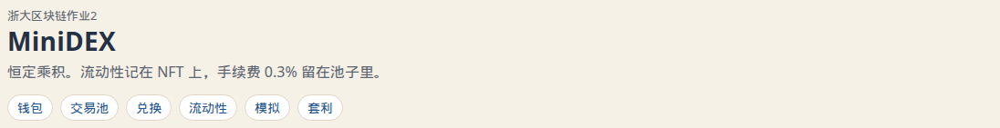

# MiniDEX

浙大区块链课作业 2。我做了个恒定乘积的交易所，流动性用 ERC721 记账。Bonus 是两个所，外加一个一笔交易里做完的套利。

学号 3230105407，魏宝龙。

## 怎么跑

Node 用 22 或 24，仓库 `.nvmrc` 写的是 24。我用 Hardhat 自带节点，没开 Ganache。

开三个终端。

第一个，别关：

```bash
cd contracts
npm ci
npm run node
```

第二个，部署。地址和 ABI 写到 `frontend/src/deployments/localhost.json`。

```bash
cd contracts
npm run deploy
```

节点刚启动时，地址和仓库里这份 json 一样。这个节点上要是已经发过交易，再跑一次 deploy。

第三个：

```bash
cd frontend
npm ci
npm start
```

打开 <http://127.0.0.1:3000>，点「使用本地测试账户」。那是 Hardhat 的 0 号账户，助记词是公开的测试助记词，只能在 chainId 31337 上用。MetaMask 也行，RPC 填 `http://127.0.0.1:8545`。

## 接 Sepolia

作业评分还是看本地 Hardhat 和截图。Sepolia 只是想把同一套合约放到测试网上玩玩，不接主网。

1. 领一点 Sepolia ETH。公共水龙头有 [sepoliafaucet.com](https://sepoliafaucet.com/) 和 [Alchemy 的 Sepolia faucet](https://www.alchemy.com/faucets/ethereum-sepolia)；免费水龙头往往很慢。gas 和池子里的 ETH 都从部署账户扣，一次部署大约需要 0.05 ETH 以上，准备 0.1 个比较稳。
2. 在 `contracts` 里把 `.env.example` 复制成 `.env`，填 `SEPOLIA_RPC_URL` 和 `DEPLOYER_PRIVATE_KEY`。私钥用测试账户，0x 开头。`.env` 已经被 gitignore，不要提交。
3. 部署。地址写到 `frontend/src/deployments/sepolia.json`。这个文件不写私钥，`rpcUrl` 用的是公共节点 `https://rpc.sepolia.org`。真正发交易的 RPC 只留在 `.env` 里。

```bash
cd contracts
npx hardhat run scripts/deploy.ts --network sepolia
```

也可以 `npm run deploy:sepolia`。池子比本地小：TKA/TKB 是 1000/1000 和 1000/2000，ETH 池只有 0.0008 和 0.0012 WETH。套利数量填 100 左右，别填本地那笔 1000。

4. `cd frontend && npm start`。MetaMask 切到 Sepolia，点「连接 MetaMask」。页面认 chainId 11155111 就读 sepolia.json，认 31337 就读 localhost.json。
5. Sepolia 上没有「领 5 ETH / 领 TKA / 领 TKB」，也没有 20 个账户模拟。那两个是本地作业水龙头。想回本地演示，点「回到本地 Hardhat」或「使用本地测试账户」。

没填 `.env` 就跑 Sepolia 部署会直接失败，这是故意的。本地 `npm test` 和 `npm run deploy` 不读这两项。

只想看 20 个账户跑一轮：

```bash
cd contracts
npm run simulate
```

检查：

```bash
cd contracts && npm ci && npm run compile && npm test
cd frontend && npm ci && npm run build
```

有个坑我踩过。ethers 会把 250ms 里的 nonce 查询缓存住，Hardhat 出块太快，授权完马上再发一笔就会 nonce too low。页面里把 `cacheTimeout` 设成了 -1。

## 我是怎么写的

一开始想把交易所塞进一个合约。兑换、加池、NFT 搅在一起，我改成工厂、池子、路由、NFT 分开。两个所就是两套工厂和路由。TKA、TKB、WETH 共用。

手续费当时想过收进一个地址，再按 NFT 去分。写到一半觉得容易算错。后来改成 Uniswap V2 那种 0.3%，少掉的直接留在储备里：

```text
amountOut = reserveOut * amountIn * 997 / (reserveIn * 1000 + amountIn * 997)
```

输入按全额加进储备。撤的时候 `取出 = 份额 * 当前储备 / 总份额`，手续费就在里面。

10000/10000 的池子打进 100：不收费大约换出 99.0099，收费之后大约 98.7158。测试里对过。

流动性我本来想发 ERC20。题目要 NFT，就改成一张 NFT 对应一整笔仓位，烧掉才取回。部分撤出要拆份额，我没做。NFT 可以转给别人，谁拿着谁取。第一笔流动性锁 1000 份，照 V2 来的，不然池子能被掏到很脏的比例。

ETH 我试过让池子直接收 `msg.value`，和 token/token 两套逻辑老打架。池子后来只认 ERC20，路由负责把 ETH 包成 WETH，取回时再拆开。两个所共用一个 WETH，套利不用管两种包装币。页面上还是写成 ETH。

部署时两边价格故意不一样，不然 Bonus 打开没得看：

| 池子 | MiniDEX-A | MiniDEX-B |
| --- | --- | --- |
| TKA / TKB | 10000 / 10000 | 10000 / 20000 |
| TKA / ETH | 5000 / 5 | 5000 / 8 |

TKB/ETH 没建。创建池子那个按钮得有个空的可以点。

模拟用的是账户 1 到 20。前 4 轮我写成固定加池。一上来没人有 NFT，撤池一直是 0，我还以为撤池写坏了。这 20 个账户不动 0 号放进去的初始 NFT。页面上的按钮和 `npm run simulate` 是同一段脚本。

兑换下面有一行价格影响，是用页面上的储备估的，0.3% 手续费算在里面。不是合约里的新字段。

## Bonus

两个工厂，同一对代币各记各的储备。

`AtomicArbitrage` 两个方向都 quote 一遍，选换回来更多的那边。`execute` 先把代币拉进来，买，再卖。卖回来的要比投进去的多，还得够 `minProfit`，不然 revert。同一笔交易，revert 之后两个池子的储备都回去。测试里有两种：本来就没价差，以及利润门槛故意设得比实际高。后一种是兑换发生之后才失败的。

事件里有数量，还有买卖两边成交前、成交后的价格。价格是中间价，1 个付出的代币值多少中间代币，不算手续费。页面上画了路径：付出的币，到便宜的所，换成中间币，再到另一边卖回来。

下面是刚部署完、还没做别的操作时，花 1000 TKA 套 TKB 的结果。预览和链上事件是同一组数。

- 在 MiniDEX-B 买入 1813.221787760298263162 TKB。那边原来 1 TKA = 2 TKB。
- 在 MiniDEX-A 卖回 1531.009044423350048493 TKA。那边原来是 1:1。
- 利润 531.009044423350048493 TKA。
- B 的价格 2 → 1.653343473839972885。
- A 的价格 1 → 1.394879490334269824。

价差从 1 收到大约 0.258。页面只留 4 位小数，所以看到的是 531.009、1813.2217。

## 和题目有出入的地方

- ETH 池用 WETH，路由包装、拆包。
- 手续费全留在储备里，没有协议费，也没有单独的手续费账户。
- 一张 NFT 一次取完，可以转让。
- 每个池子第一笔锁 1000 份。太小的余额页面写成 `<0.0001`，不然看起来像 0。
- 可以直接用 0 号测试账户，不强制装 MetaMask。
- 只给 TKA/TKB 和 TKA/ETH 放了初始流动性。

## 截图

本地 Hardhat 上点的。页面用的是深色，兑换卡片在最上面，池子和钱包在旁边。套利那张是成交前的预览，后面几张是接着操作的。

页头。标题停一下会有一行字，控制台里我也留了一句。



连上 0 号账户，还没领币：


两个所的初始池子。A 上 1 TKA = 1 TKB，B 上 1 TKA = 2 TKB。


MiniDEX-A 的 TKA/TKB。可取的比当初放进去少一点点，是锁了 1000 份。


还没交易时，用 10 个 TKA 换 TKB。下面那行是价格影响，新鲜池子大约少 0.39%，几乎就是那 0.3% 手续费。


花 1000 TKA 的套利预览，上面是路径：


同一笔在链上执行完，数字和预览一样：


套利之后再在 MiniDEX-A 用 10 TKA 换 TKB，报价大约 13.8905。池子已经被搬过一次，价格影响比刚才大。


领过 TKA 和测试 ETH：


自己建的 MiniDEX-A，1 ETH 配 1000 TKB。合约会把代币排成 ETH/TKB：


这张新建的 NFT 销毁取回之后，0 号原来的仓位还在。A 上那张 TKA/TKB 能取回的 TKB 变多、TKA 变少，就是刚才套利和兑换留下的。


页面上跑 24 轮、20 个账户。这一轮是兑换 9、加池 13、撤池 2：


窄屏时兑换卡片在上，池子表可以横滑，第一列钉住：


命令行 `npm run simulate` 再跑 30 轮，是在页面已经交易过之后跑的，结果兑换 14、加池 14、撤池 2。价格和刚部署时不一样。

录屏不放在仓库里，另外交。

## 参考

- 课程 Demo：<https://github.com/LBruyne/blockchain-course-demos>
- OpenZeppelin 向导，ERC20 和 ERC721 我是从那生成再改的：<https://wizard.openzeppelin.com/>
- WTF 的 DEX 那篇，看 ETH 怎么换：<https://www.wtf.academy/en/docs/solidity-103/DEX/>
- 手续费和锁 1000 份参考 Uniswap V2。代码没搬过来，LP 按题目做成了 NFT。
