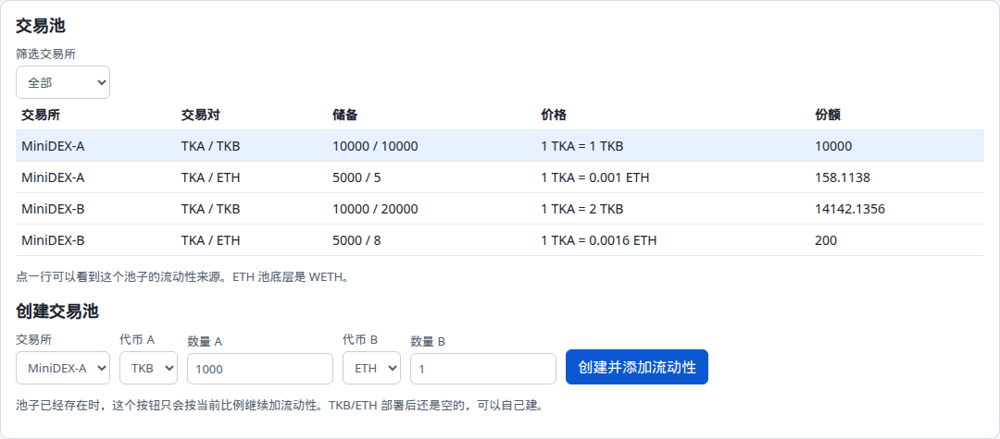
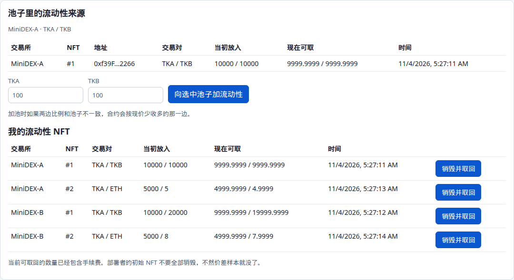
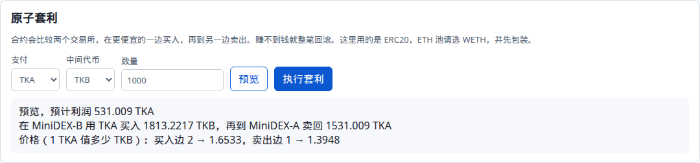
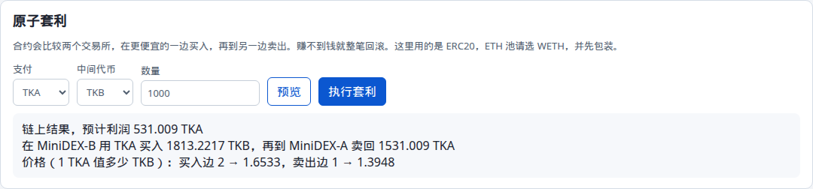
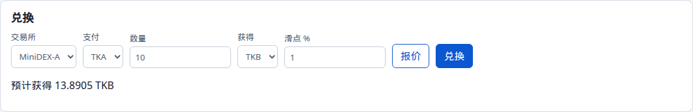
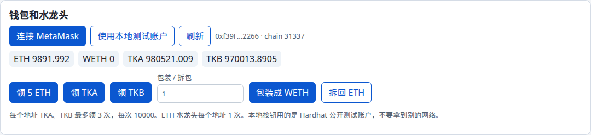
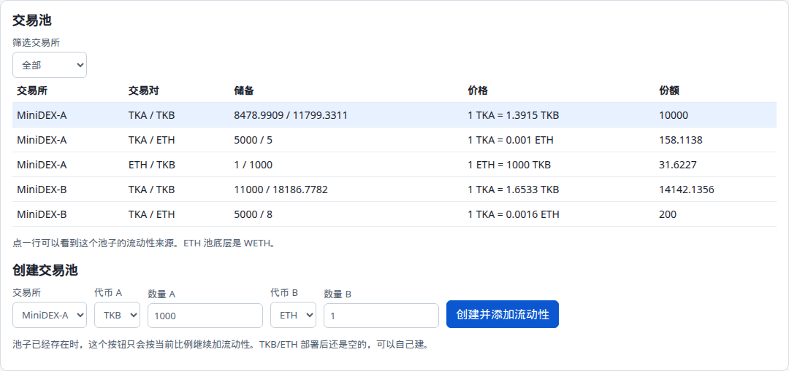
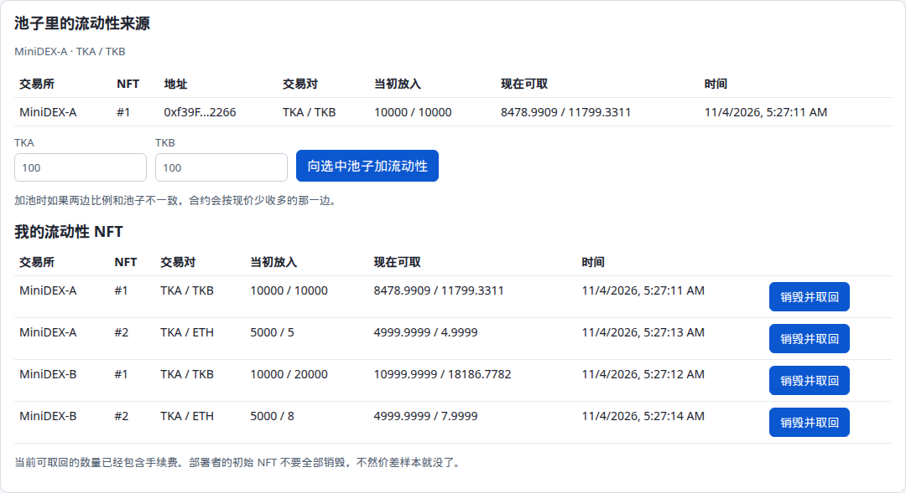
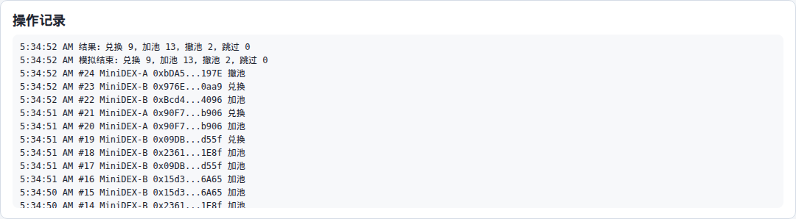
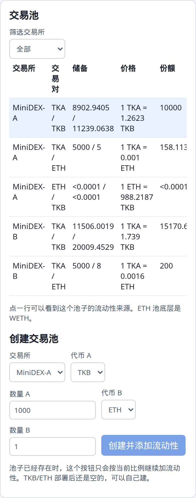

# MiniDEX

这是区块链课程第二次作业：一个用恒定乘积做市的交易所，再加一个原子套利合约。

页面上可以领测试币、建池、兑换、添加和取回流动性。流动性凭证是 ERC721，不是同质化的 LP Token。另外部署了两套交易所，同一对代币的价格可以不一样，套利合约在一笔交易里低买高卖，不赚钱就整笔回滚。

## 怎么跑

需要 Node.js 22 或 24（仓库里 `.nvmrc` 写的是 24）。下面用 Hardhat 自带节点，不用另开 Ganache。

开三个终端。

第一个，启动节点（保持不要关）：

```bash
cd contracts
npm ci
npm run node
```

第二个，部署。脚本会写 `frontend/src/deployments/localhost.json`，里面是地址和 ABI。

```bash
cd contracts
npm run deploy
```

节点是新开的时候，地址和仓库里这份 json 一致。如果这个节点上已经发过交易，nonce 变了，地址会变，再跑一次 `npm run deploy` 就行。

第三个，打开页面：

```bash
cd frontend
npm ci
npm start
```

浏览器打开 <http://127.0.0.1:3000>。点「使用本地测试账户」会用 Hardhat 的 0 号账户（助记词是公开的测试助记词，只能在 chainId 31337 上用）。装了 MetaMask 的话也可以连，网络要切到 `http://127.0.0.1:8545`，chainId `31337`。

只想在命令行看 20 个账户跑一轮，节点和部署都就绪之后：

```bash
cd contracts
npm run simulate
```

检查合约和前端：

```bash
cd contracts && npm ci && npm run compile && npm test
cd frontend && npm ci && npm run build
```

## 功能是怎么做的

合约没有做成一个大合约，拆成下面几块。两套交易所各有自己的工厂、路由和 NFT，代币和 WETH 是共用的。

- `TestERC20`：TKA、TKB。`claim` 每次 10000，每个地址最多 3 次。部署者还可以 `mint`。
- `EthFaucet`：每个地址领一次 5 ETH。部署时给水龙头打了 100 ETH。
- `WETH`：ETH 池实际存的是 WETH。路由在加池和兑换时负责包装、拆包，页面上写成 ETH。
- `DexFactory` / `DexPair`：建池、记账。价格用 `x * y = k`。
- `DexRouter`：用户只跟路由打交道。加池、撤池、兑换都在这里。
- `LiquidityNFT`：一张 NFT 对应一笔流动性。里面记了池子地址、份额、当初放进去的数量和时间。
- `AtomicArbitrage`：比较两个路由，选利润更高的方向，一笔交易里买完再卖。

手续费按 Uniswap V2 的 0.3% 来，也就是分子乘 997、分母用 1000：

```text
amountOut = reserveOut * amountIn * 997 / (reserveIn * 1000 + amountIn * 997)
```

扣掉的 0.3% 不另开账户，直接留在池子里。所以输入侧储备增加的是全部 `amountIn`，k 不会变小。LP 撤出时按份额分储备，手续费就在里面。

举个整数例子。池子两边都是 10000，打进去 100：

- 不收手续费大约换出 99.0099
- 收 0.3% 之后换出 98.7158

份额：

- 第一笔流动性是 `sqrt(amount0 * amount1)`，其中 1000 份锁在池子里，谁也拿不走（和 V2 一样，避免池子被掏空到除法出问题）。
- 之后按两边储备的比例取较小的那份。
- 销毁时 `取出 = 份额 * 当前储备 / 总份额`。

NFT 只能由路由铸造和销毁，避免有人只烧 NFT、钱还留在池子里，或者绕过 NFT 直接改储备。NFT 可以转给别人，新的持有人可以取回。一次销毁取回整笔，不做部分撤出。

部署时在两个交易所放了不同的初始价格，方便直接看到价差：

| 池子 | MiniDEX-A | MiniDEX-B |
| --- | --- | --- |
| TKA / TKB | 10000 / 10000 | 10000 / 20000 |
| TKA / ETH | 5000 / 5 | 5000 / 8 |

TKB/ETH 故意没建，页面上可以用「创建并添加流动性」自己建。

模拟用的是 Hardhat 的第 1 到第 20 号账户。先领币、授权，再随机兑换、加池、撤池。前 4 轮固定加池，不然一开始没人有 NFT，撤池没东西可撤。不会去动部署者那几张初始 NFT。页面上的「开始模拟」和 `npm run simulate` 走的是同一段脚本。

## Bonus

两个工厂就是两个交易所，交易对可以相同，储备各自记。

套利合约 `preview` 两个方向都算一遍，留下拿回来更多的那一边。`execute` 做的事：

1. 从调用者转入付出的代币
2. 在便宜的池子换成另一种代币
3. 立刻在另一个池子卖回
4. 要求卖回来的数量大于付出的数量，并且利润不低于 `minProfit`
5. 利润不够就 `revert`，两笔兑换一起作废

事件 `ArbitrageExecuted` 里有成交数量，以及买卖两边在成交前、成交后的现货价格（1 个付出代币值多少中间代币，不含手续费的中间价）。

下面这组数是部署完、还没做别的交易时，花 1000 TKA 去套利 TKB 的结果。页面上「预览」和真正执行打出来的事件一致。

- 在 MiniDEX-B 买入（那边 1 TKA 本来值 2 TKB），得到 1813.221787760298263162 TKB
- 在 MiniDEX-A 卖出（那边本来是 1:1），换回 1531.009044423350048493 TKA
- 利润 531.009044423350048493 TKA
- B 的价格 2 → 1.653343473839972885
- A 的价格 1 → 1.394879490334269824

价差从 1 收到大约 0.258。页面只显示 4 位小数，所以会看到 531.009、1813.2217 这种。

如果两个池子价格一样，`preview` 认为没有利润，`execute` 在兑换之前就 revert。如果把 `minProfit` 设得比实际利润还高，兑换会先发生，然后在检查利润时 revert，储备回到交易前。测试里这两边都有。

## 和题目不完全一样的地方

1. ETH 交易对底层是 WETH。路由收原生 ETH 再包装，取回时再拆开。两个交易所共用同一个 WETH，套利不用处理两套包装币。
2. 手续费 0.3%，全部留在储备里按份额分，没有协议费，也没有单独的手续费账户。
3. 一张 NFT 就是一整笔仓位，销毁时一次取完。NFT 可以转让。
4. 每个池子第一次加流动性会锁住 1000 份份额，最后一个人也取不干净。页面上小于 0.0001 的余额会显示成 `<0.0001`。
5. 本地演示可以直接用 0 号测试账户，不强制装 MetaMask。20 个模拟账户不碰部署者的初始 NFT。
6. 只给 TKA/TKB 和 TKA/ETH 做了初始流动性。TKB/ETH 留空，用来演示建池。

## 截图

本地 Hardhat 上点出来的。套利那张是成交前的预览，后面几张是同一轮操作里接着做的。

连上 0 号账户，领币之前的余额：


两个交易所的初始池子。A 上 1 TKA = 1 TKB，B 上 1 TKA = 2 TKB。



点进 MiniDEX-A 的 TKA/TKB，能看到这笔流动性是谁提供的，下面是自己的 NFT。可取数量比当初放进去少一点点，是因为锁了 1000 份。



花 1000 TKA 的套利预览：



同一笔在链上执行之后，事件里的数字和预览一样：



套利之后在 MiniDEX-A 用 10 TKA 换 TKB，报价大约 13.8905：



领过 TKA 和测试 ETH：



自己建的 MiniDEX-A TKB/ETH 池，1 ETH 配 1000 TKB：



把这张新建的 NFT 销毁取回之后，部署者原来的仓位还在。A 上那张 TKA/TKB 现在能取回的 TKB 变多、TKA 变少，就是刚才套利和兑换留下的。



页面上跑 24 轮、20 个账户。这一轮是兑换 9、加池 13、撤池 2：



窄屏下表单会换行，池子表格可以横着看：



命令行 `npm run simulate` 再跑 30 轮的结果是兑换 14、加池 14、撤池 2，没有跳过。那是在页面已经交易过一轮之后跑的，所以价格和刚部署时不一样。

录屏不放在仓库里，提交时另外发。

## 参考

- 课程 Demo：<https://github.com/LBruyne/blockchain-course-demos>
- OpenZeppelin 的 ERC20 / ERC721 向导：<https://wizard.openzeppelin.com/>
- WTF Solidity DEX，看 ETH 和 ERC20 怎么兑换：<https://www.wtf.academy/en/docs/solidity-103/DEX/>
- 手续费和首笔流动性锁仓的算法参考 Uniswap V2。这里没有把 V2 的代码搬进来，LP 凭证按题目做成了 ERC721。
